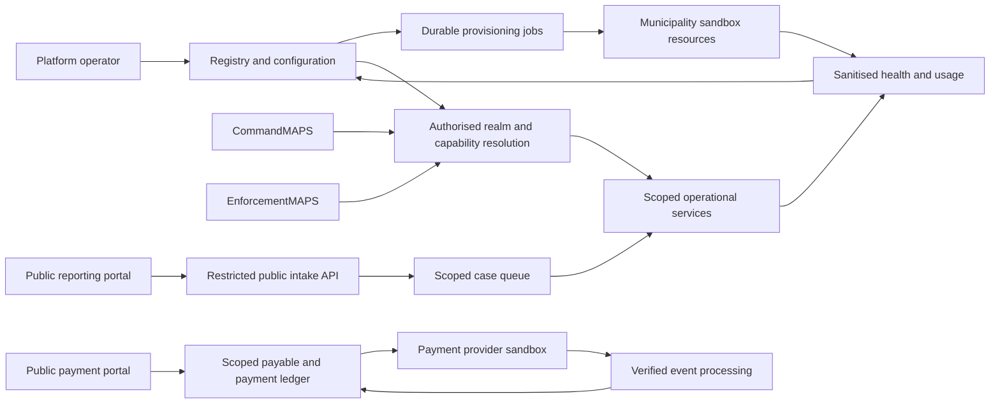

# CivicMAPS Platform — ecosystem assessment and autonomous delivery plan

Assessment date: 13 October 2026. Author: Codex (agent).
Repository: TechCorp25/CivicMaps-rebuild.
Assessed baseline: `work` at `34a6a2ec65bb43ca75e1df2ebfe37caed4517857` (platform implementation plus merge from main).
This deliverable is an assessment and execution plan; the features below are not claimed as implemented.

**Historical F06Q/D02 checkpoint — 18 October 2026:** merged F06Q source `3dfb0316fbe7885c55adbb1861ff58d199ca5810` was deployed and live accepted, including both review corrections. The [release-closure evidence](evidence/F06Q-release-closure.md) records preservation, recovery and rollback/return checks. The owner approved [F07 D02 policy](F07-D02-decisions.md). Do not repeat this completed deployment or ask for those decisions again. Use the [feature ledger](civicmaps-feature-ledger.json) and [F07 handoff](F07-handoff.md) for current state; the later F07 deployment is recorded in its own release closure. The original assessment below remains historical evidence for its stated baseline.

**Historical F07-to-F08 implementation checkpoint — 18 October 2026 (superseded by deployed F08 and the governance gate below):** owner-merged F07 source `2b73318` is deployed/live accepted. [Release closure](evidence/F07-release-closure.md) records preservation, real TLS Alpha/Beta activation/isolation/revocation and compatible recovery. Alpha's synthetic administrator is retained; Beta's administrator is disabled, with council resources preserved. At that checkpoint, [owner-approved D03](F08-D03-decisions.md) preceded F08 implementation. F08 has since been implemented, owner-merged, deployed and live accepted; preserve its entitlement enforcement and do not reimplement it. Do not repeat F07 activation/deployment or re-request D02.

**Current owner governance gate — 18 October 2026:** PR22 is owner-merged; F08 remains deployed/live accepted. The owner requires governance/compliance across all Australian states and territories, council self-administration and operator/council isolation to be resolved before deeper feature implementation. Use the [current 65-finding assessment](evidence/2026-10-18-governance-review.md), [governance requirements and remediation gate](governance-and-production-readiness-gate.md), and current ledger. F09 is blocked pending this work and its concrete suspension policy; earlier feature sequencing below is subject to this gate. No new production policy, domain, infrastructure expenditure or data migration is approved by publication.

## Outcome

CivicMAPS Platform is a compilable local control-plane slice, not yet a municipality sandbox deployment or service-management system. CommandMAPS has a working foundation slice in source. EnforcementMAPS web/mobile and the public portal are placeholders. The missing integration is a durable, authorised connection between the municipality registry, operational tenancy, deployment resources, users, pack entitlements and public services.

Use one feature at a time, with the acceptance evidence below, to turn this into an integrated sandbox demonstration. A production rollout is a later release decision. Do not describe a registry row, synthetic Active status, successful build, or payment redirect as proof of a live service.

## Evidence and current connections

All paths below refer to the assessed commit, not an older local checkout.

| Area | Observed implementation | Gap / implication |
| --- | --- | --- |
| Platform UI | [Platform README](../../apps/civicmaps-platform/README.md), React UI, onboarding wizard, directory, pack toggles and health screens under `apps/civicmaps-platform/src` | S12–S15 local slice; browser acceptance coverage absent |
| Platform API | [platform.mjs](../../services/api/platform.mjs): separate operator sessions, CSRF, transactional audit, idempotency, immutable slug, versioned pack updates | Registration creates municipality and pending first-admin records only; no provisioning worker or activation API |
| Database boundary | [003-platform.sql](../../services/api/migrations/003-platform.sql): distinct control-plane role with no operational-table grants | Both API areas share a process and [connection pool](../../services/api/database.mjs); role switching is not a separate runtime/network sandbox |
| Operational tenancy | [001-foundation.sql](../../services/api/migrations/001-foundation.sql), [002-auth-scope.sql](../../services/api/migrations/002-auth-scope.sql), [app.mjs](../../services/api/app.mjs): scoped actors, requests, audit, RLS and contextual role switching | Municipality UUIDs are not bound to operational tenant/organisation/jurisdiction/data-plane identities |
| Council identities | Operational user role constraint is DISPATCHER/OFFICER/SUPERVISOR; first admins live in a separate pending table | A registered first admin cannot become a council ADMIN through the current implementation |
| CommandMAPS | Scoped request creation, assignment, acknowledgement, attendance and closure | No registry status or domain-pack checks in operational routes; no complete infringement, permit or public intake model |
| EnforcementMAPS | [web scaffold](../../apps/enforcementmaps-web/README.md), [mobile scaffold](../../apps/enforcementmaps-mobile/README.md); source directories contain placeholders | Officer paths in the shared API do not constitute deployed web/mobile applications; offline sync and device verification absent |
| Public reporting | [portal scaffold](../../apps/public-portal/README.md); [S22](../wireframes/screens/Wireframes%20S22%20-%20Public%20Service%20Request%20Submission.dc.html) describes unauthenticated intake into the S17 case queue | No public API, upload boundary, case intake implementation or private tracking capability |
| Payments | [S25](../wireframes/screens/Wireframes%20S25%20-%20Payment%20Portal.dc.html) describes infringement and approved-permit payments | No payable ledger, provider adapter, verified webhook, reconciliation, receipt or refund implementation |
| Pack catalogue | Eight display-name strings in platform.mjs, stored as JSON | No stable capability IDs/mapping to operational branches. Existing parking fixture must be explicitly mapped, not silently equated with Local Laws |
| Health/workload | [seed-platform.mjs](../../services/api/seed-platform.mjs) loads synthetic metrics and workload snapshots | No telemetry collector, freshness policy, measured readiness or real open-record counts |
| Deployment | Root scripts build two Vite apps and run a loopback Express server | No delivery pipeline under `.github` in inspected tree, no resource provisioning, DNS/TLS reconciliation, backup/restore verification or service inventory |
| Build reproducibility | [package.json](../../package.json) includes both web apps; root `package-lock.json` is zero bytes | Clean reproducible installation is not established; repair before calling CI/release reliable |
| Instructions | Root AGENTS.md says no Git/manifests/tests; [local build guide](../development/local-build.md) and source contradict those stale statements | Reconcile instructions against current facts in F01. Preserve current user authority and explicit unresolved product decisions |

The [tenancy model](../architecture/CivicMAPS_Architecture_Configuration_and_Tenancy_Model_v0.1.0.md) distinguishes Tenant, Organisation, Jurisdiction, Data Plane and Authority Realm. Keep those distinctions: a municipality entry must not become an irreversible one-municipality/one-tenant assumption.

### Connection model to implement

This is a proposed logical connection map, not a selection of hosting provider, identity provider or physical isolation technology. Platform operators receive explicit audited management actions, not automatic access to council case contents.

## Verification performed

- Local checkout was clean at `9e56799`, older than remote `work`. Git fetch failed because the inherited proxy at proxy:8080 was unreachable. GitHub connector reads succeeded.
- Reconstructed the assessed source in an isolated workspace snapshot using the local ancestor and all 20 changed files returned by GitHub comparison. Used existing installed dependencies; no fresh dependency resolution.
- `npm run typecheck`: passed for CommandMAPS and CivicMAPS Platform.
- `npm run build`: passed for both apps (Vite 6.4.3; Node 24.19.0, npm 11.9.0).
- Root lockfile size and JSON validity checked: 0 bytes, invalid JSON.
- `npm test`: failed at test-file level before individual cases were reported. TAP rerun also failed. A separate default local PostgreSQL connection probe returned EPERM; database-backed correctness is unverified in this executor.
- Existing `tests/foundation.test.mjs` exercises operational scope/lifecycle/CSRF/concurrency; it does not exercise platform routes. `tests/browser.mjs` targets port 5173, not Platform on 5174.
- No browser, native-device, cloud provisioning, public reporting or payment-provider execution was performed. No production endpoints or payment credentials were used.

## Completion protocol for a long-running Codex session

1. Read this plan, AGENTS.md, affected module READMEs, latest feature ledger and relevant Empirical memories. Inspect Git status and compare branch/base SHAs. Preserve unrelated work.
2. Select the lowest-numbered ready feature whose dependencies have evidence of completion. Keep exactly one feature `in_progress`. Clarify only an unresolved decision that blocks that feature; work on another independent ready feature if available.
3. Create a fresh `codex/civicmaps-fNN-<slug>` branch from the reviewed integration base. Use a separate worktree for isolation where possible. If a dependent feature must continue before owner merge, explicitly stack its branch on the completed prerequisite and target that prerequisite branch in its draft PR.
4. Capture a failing acceptance scenario where meaningful, implement only the stated feature, then run its targeted checks and affected regression checks. Use synthetic Alpha/Beta municipalities, distinct accounts and isolated disposable resources.
5. Record acceptance results, exact commands, source SHA, environment, changed files, screenshots where relevant, remaining limitations and rollback steps in `docs/plans/evidence/FNN.md`. A mock/provider simulator result is not live-provider evidence.
6. Commit feature code and evidence; push the fresh branch; verify the remote SHA. Open a focused draft PR for owner review. Do not merge or enable auto-merge. Keep any existing implementation changes out of unrelated feature PRs.
7. Update Empirical with explicit `authorType: agent`, tags `CivicMaps-rebuild,civicmaps-platform,work-history,FNN`, outcome, commit, branch, PR, checks, limitations and next feature. Never include secrets, citizen records or temporary passwords. Retry failed memory calls once under the Empirical skill.
8. Mark `review_ready` only after acceptance checks, publication and memory update succeed. Track implementation status separately from publication/memory status so a network failure cannot falsely mark work complete. Owner merge changes status to `merged`; an agent must not infer merge from a pushed branch.
9. Checkpoint after each meaningful milestone and before compaction/interruption: feature ID, branch/HEAD, dirty paths, completed criteria, exact next action, failed command and blocker. Resume from evidence instead of repeating completed operations. Retry transient failures at most twice per checkpoint; investigate repeat failures and mark blocked rather than looping.
10. Continue while ready work exists. Stop only when all authorised goals are review-ready, an essential decision/access dependency blocks all remaining work, or the user stops the session. Do not broaden a feature to fill waiting time.

A feature is implementation-complete only when its observable goal, negative cases, relevant regression checks and rollback evidence pass. Builds alone cannot close an API, tenancy, payment or deployment feature.

## Decisions to resolve at the relevant boundary

These are concrete product/operating inputs, not blanket approval gates on routine coding:

- D01: sandbox isolation level, hosting account/provider, region/residency, resource budget and retention; platform/public hostnames. Existing unresolved OQ12-1 and current local runtime do not select a production deployment boundary.
- D02: [F07 permissions and activation delivery/recovery policy are owner-approved](F07-D02-decisions.md). Later organisation/team administration still needs its own explicit scope and audited operator authority.
- D03: [owner-approved F08 policy](F08-D03-decisions.md), implemented and owner-merged: stable IDs/parking mapping, retained authorised request/audit review (ADMIN excluded), write-before-disable ordering and audited re-enable. F09 municipality-wide suspension is a distinct policy boundary; its proposed choices are in the [F09 plan](F09-next-phase-plan.md).
- D04: public-report categories, anonymous-report tracking/privacy rule, attachment limits/retention. S22 says anonymous reports have no status link; preserve that default until changed explicitly.
- D05: payment provider and council merchant ownership, currencies, authoritative amounts, infringement lookup factors, refunds/partial payments, and permit approve-versus-issue sequencing. S25/OQ25-1 explicitly conflicts with earlier permit issuance timing.
- D06: service health thresholds, freshness, support alerts and agreed recovery objectives. Synthetic Healthy labels are not an SLO.

Prepare adapter contracts and local synthetic proofs while external choices are pending. Do not pick a provider, real merchant account, legal penalty schedule or live hostname implicitly. Historical ADR boilerplate must not prevent evidence gathering or work already authorised by the user.

## Feature queue

Each card is a single independently reviewable outcome. Dependencies refer to these cards; all begin planned. Target order is the order below, skipping only blocked cards whose dependants are not being executed.

### F01 — Reproducible build baseline
**Depends on:** none. **Goal:** a fresh checkout installs and builds deterministically.
**Scope:** restore a valid root lockfile against the existing manifest; reconcile obsolete AGENTS/build documentation; add CI for existing apps with disposable PostgreSQL.
**Done when:** clean install, both typechecks/builds and current foundation suite pass from the pinned commit; CI does not claim scaffold apps were tested.
**Rollback:** revert build/configuration changes; retain prior source. No feature logic changes.

### F02 — Platform registration acceptance coverage
**Depends on:** F01. **Goal:** prove the current S12–S15 contract.
**Scope:** platform API tests plus browser registration/pack flows.
**Done when:** duplicate slug/email and parallel retry create one municipality/audit; replay omits plaintext password; stale versions and missing CSRF fail; council cookies cannot access platform routes and platform role cannot read operational tables; keyboard navigation, reload/session restoration and errors verified.
**Rollback:** test/configuration commit only; defects needing new behaviour get a separately scoped card.

### F02Q — Enforced code quality baseline
**Depends on:** F02. **Goal:** keep implemented application code readable and automatically checked before context binding expands it.
**Scope:** pinned ESLint flat configuration for JavaScript/TypeScript and React Hooks; separately configured Prettier; root lint/format checks in CI. Include implemented app source, API, active scripts and tests; explicitly exclude archives, generated tokens, build output and scaffolds. Format in a mechanical commit, then make bounded lint/DRY corrections. Retain existing auth-plane separation and framework choices.
**Done when:** lint reports zero warnings, formatter check passes, both typechecks/builds, all 18 API cases and platform browser acceptance pass; generated tokens remain unchanged. Resolve effect dependencies without blanket suppressions; preserve cancellation and same-ID page navigation. Extract shared disposable test lifecycle where it removes repeated ownership/cleanup logic, retain explicit test scenarios, and remove duplicate narrow screenshot capture. Add short why-comments for route-page refetch, table positioning, retry-secret omission and role/transaction boundaries, with relative links to evidence where useful. Inspect formatted components; split only coherent views that materially reduce branching/ownership complexity. No arbitrary line-count target or speculative abstractions.
**Evidence:** `docs/plans/evidence/F02Q.md` with exact versions, commands, exclusions, CI URL, behavioural diff and unresolved findings. Record each gotcha with symptom, cause, fix and prevention in Empirical.
**Rollback:** revert tooling and refactor commits; no schema changes. Keep existing acceptance tests.

### F03 — Municipality-to-operating-context binding
**Depends on:** F02, F02Q. **Goal:** registry entries resolve to explicit permitted operating contexts.
**Scope:** versioned municipality/tenant/organisation/jurisdiction/data-plane associations and realm resolution; no infrastructure.
**Done when:** Alpha/Beta isolation and a shared-service association fixture pass; forged/unset/expired context fails closed; operational origin remains immutable; mapping migration is repeatable.
**Rollback:** disable new bindings without deleting operational records; document migration compatibility.

### F04 — Durable provisioning job lifecycle
**Depends on:** F03. **Goal:** registration can request an observable, restartable provisioning operation.
**Scope:** job state, idempotent steps, retry/lease handling, status UI and fake adapter.
**Done when:** crash/restart and duplicate delivery resume the same job; failed steps never mark municipality Active; audit links actor/job/resource IDs; reconcile and retry are visible.
**Rollback:** pause worker; preserve jobs and registry for diagnosis. Fake adapter must remain visibly synthetic.

### F05 — Provision isolated municipality data resources
**Depends on:** F04; D01. **Goal:** a chosen sandbox boundary is created through the job adapter.
**Scope:** one approved data isolation implementation, migrations, least-privilege runtime credentials and evidence storage namespace; no public routing.
**Done when:** create two disposable sandboxes; API, direct runtime DB credentials and object access cannot cross boundaries; failed creation leaves recoverable state; migration replay works without data loss.
**Rollback:** remove only explicitly tagged empty test resources; retain populated resources and disable access. Record exact resource inventory.

### F06 — Municipality service routing
**Depends on:** F05; D01 hostname decision. **Goal:** a registered sandbox has verified service destinations.
**Scope:** trusted host-to-context resolution, routing manifest, TLS/ingress adapter and readiness probes.
**Done when:** Alpha/Beta hosts resolve correctly; unknown/forged Host and forwarded-host values fail closed; credentials do not travel to another tenant; routes remain unavailable until resources are ready.
**Rollback:** withdraw new route mapping; retain data and job history.

### F06Q — Routing reliability and release alignment
**Depends on:** merged F06. **Goal:** recoverable routing, isolated login throttling and truthful current status on the existing approved development release.
**Scope:** bounded durable retries and restricted out-of-band Platform recovery; trusted-ingress client key with route/client/identity limits; serial detail polling and readiness expiry; truthful health mode; controlled release of migrations 010/011 with owned backup and data-preserving rollback.
**Done when:** transient/terminal/crashed/stale workers, withdrawal, genuine Caddy client isolation, forged/duplicate headers and Chromium refresh/expiry/navigation pass; exact-source deployment, current live TLS/isolation and rollback are executed and recorded. Local proof alone cannot close release alignment.
**Evidence:** [F06Q evidence](evidence/F06Q.md), [runbook](../development/service-routing.md#f06q-reliability-update), [17 October assessment](civicmaps-status-assessment-2026-10-17.md), and [implementation prompt](F06Q-next-phase-prompt.md).
**Rollback:** pause routing first; restore the recorded previous application/Caddy source with compatible additive schema; retain populated control data, ownership, sessions and history. Withdrawn routes stay closed.

### F07 — First council-admin activation
**Depends on:** F03, F05, F06Q; D02. **Goal:** pending first admin becomes an authorised council user.
**Scope:** one-time expiring activation, credential recovery and minimal council ADMIN permissions; preserve operator/council identity separation.
**Done when:** activation is single-use, scoped and audited; expired/replayed tokens fail; lost initial response has safe recovery; council admin cannot gain platform rights; account disable revokes access.
**Rollback:** revoke activation/session state and disable account; preserve audit.

### F08 — Server-enforced pack entitlements
**Depends on:** F03, F07; D03. **Goal:** pack changes govern operational service access.
**Scope:** stable pack catalogue, branch/capability mapping, versioned entitlement resolution and server checks; UI consumes the same result.
**Done when:** disabled capability is denied through direct API calls as well as UI; stale cached grants cannot reopen access; retained records obey the agreed review policy; re-enable restores authorised access without recreating records.
**Rollback:** restore previous configuration version, not a permissive bypass.

### F09 — Municipality suspension and resumption
**Depends on:** F06–F08. **Goal:** an operator can suspend a sandbox without deleting its records.
**Scope:** audited status transition, access/session enforcement and UI state.
**Done when:** in-flight and subsequent operations follow a tested suspension policy across staff/public entry points; resumption requires healthy resources; another municipality is unaffected.
**Rollback:** audited resume to prior state after readiness checks. Later public/payment features must extend these tests.
**Preparation:** [F09 plan](F09-next-phase-plan.md) defines bounded scope, dependencies, acceptance and TODOs. Access/session/in-flight/readiness choices there are proposals, not owner-approved policy. F08 deployment/live acceptance/recovery and supplemental source verification are complete, supported by inspected original AWS receipts in [F08 closure](evidence/F08-release-closure.md).

### F10 — Audited council organisation management
**Depends on:** F03, F07; D02. **Goal:** authorised platform operators manage a council's team structure through explicit actions.
**Scope:** one organisation/team editing API and UI slice, with version conflicts and audit.
**Done when:** no silent tenant override; wrong-realm edits fail; referenced teams cannot be destructively removed; concurrent edits conflict; council users see only permitted structure.
**Rollback:** restore prior configuration version; preserve audit and record origins.

### F11 — CommandMAPS sandbox connection
**Depends on:** F06–F08. **Goal:** a newly provisioned council can use the existing request lifecycle.
**Scope:** replace fixture-only context assumptions with resolved municipality configuration and permissions in CommandMAPS.
**Done when:** activated council admin provisions authorised dispatch/officer access; create → assign → acknowledge → attend → close succeeds within its realm; a second council cannot list, assign or inspect its audit; disabled pack is denied.
**Rollback:** disable service route for affected sandbox; preserve requests.

### F12 — EnforcementMAPS web dispatch slice
**Depends on:** F11. **Goal:** officers use a dedicated web surface for assigned work.
**Scope:** replace web scaffold with sign-in, assigned-request list/detail, acknowledgement and attendance using existing API contracts.
**Done when:** real browser workflow passes for two municipalities; officer cannot see unassigned/other-council work; refresh/version conflict and session expiry recover; narrow-screen and keyboard checks pass.
**Rollback:** disable EnforcementMAPS web route; existing request state remains valid. Excludes infringement issuance and offline operation.

### F13 — EnforcementMAPS mobile dispatch slice
**Depends on:** F12; selected mobile runtime where required. **Goal:** the same bounded officer workflow works on a device.
**Scope:** mobile sign-in, assigned requests, acknowledge/attend; online mode only, with explicit unavailable state offline.
**Done when:** device/emulator demonstration and API isolation tests pass; credentials use platform secure storage; disconnect never implies success; no public-portal or CommandMAPS chrome is substituted for mobile acceptance.
**Rollback:** disable release/feature flag. Durable offline sync remains a separate follow-up, not a claimed capability.

### F14 — Public case intake contract
**Depends on:** F03, F08; D04. **Goal:** one public report becomes one council-owned case.
**Scope:** restricted unauthenticated intake API, case schema, category validation, consent/provenance and idempotent submission; no uploads yet.
**Done when:** untrusted payload cannot select ownership, staff role or internal state; host resolves council; disabled/non-public categories fail; anonymous reports carry no tracking credential; duplicate submit does not duplicate cases; abuse limits are exercised.
**Rollback:** disable intake; retain accepted cases and audit.

### F15 — CommandMAPS public-report triage
**Depends on:** F11, F14. **Goal:** council staff can triage submitted public cases.
**Scope:** one case queue/detail/assign/outcome slice, following S17 rather than silently converting public reports to Code21.
**Done when:** F14 report appears in its council queue; permitted staff assign and close it; internal notes/reporter contact are permission-scoped; other council cannot read it.
**Rollback:** hide triage entry, retain cases; public status reports unavailable until restored.

### F16 — Public reporting portal
**Depends on:** F06, F14, F15. **Goal:** residents submit a report from the correct council portal.
**Scope:** replace portal scaffold with S22 identity/category/location/description/review/receipt flow.
**Done when:** mobile and desktop browser submission reaches F15 exactly once; council branding/context is correct; disabled category, validation, retry and unavailable states are accessible; anonymous/no-contact behaviour matches D04.
**Rollback:** disable submit route with a service-unavailable explanation; do not discard accepted submissions.

### F17 — Private public-report tracking
**Depends on:** F16; D04. **Goal:** eligible reporters see a safe status projection.
**Scope:** high-entropy revocable tracking capability and public status projection, with optional configured notification adapter.
**Done when:** sequential references alone cannot expose records; expired/revoked/wrong-council tokens fail without revealing existence; internal notes, staff details and other reporters' data never appear; anonymous reports receive no link under current S22 rule.
**Rollback:** revoke capabilities/disable tracking; staff records remain intact.

### F18 — Tenant-scoped report attachments
**Depends on:** F05, F16; D04. **Goal:** a reporter can attach evidence safely to their submitted case.
**Scope:** bounded upload, quarantine/validation, scoped object references and authorised staff retrieval.
**Done when:** disallowed/oversized files fail; pending scan is not downloadable; wrong-tenant object access and forged references fail; orphan cleanup/retention are tested; file processing failure does not falsely mark case evidence available.
**Rollback:** disable new uploads; retain accepted evidence under agreed retention, with audit.

### F19 — Payable instrument ledger
**Depends on:** F03, F08; D05 amount and instrument rules. **Goal:** payable obligations have authoritative, immutable ownership and amount provenance.
**Scope:** council-scoped payable contract, currency/minor-unit amounts, instrument/version reference and balance states.
**Done when:** only authorised domain producers can create obligations; public clients cannot set amount, council or settlement state; duplicate instrument does not double debt; fixtures cover infringement and approved-permit fee.
**Rollback:** disable creation; preserve all financial history.
**Boundary:** real infringement issuance and permit approval producers are not implemented today. Synthetic fixtures may prove this card, but real-service activation requires separately completed producer features; no invented penalties or automatic legal issuance.

### F19A — Authorised infringement payable producer
**Depends on:** F19; reviewed offence/penalty and notice-reference rules from D05.
**Goal:** one authorised infringement record produces one payable obligation.
**Scope:** minimal issued-record API with version-pinned legal/amount provenance and immutable notice reference; excludes the full field evidence/printing workflow.
**Done when:** authorised issuer creates a synthetic legally-configured example; invalid catalogue/version/authority fails; duplicates do not produce a second notice or payable; review preserves original facts; no client-supplied payment amount overrides the catalogue.
**Rollback:** disable issuance; preserve issued records and financial history. Without approved source rules this remains blocked, not a fixture presented as legal issuance.

### F19B — Approved permit-fee producer
**Depends on:** F19; reviewed permit type, fee and sequencing from D05.
**Goal:** approval of one configured permit type produces one fee obligation.
**Scope:** minimal application/reviewer decision and approved-awaiting-payment state; one permit type, no broad permit catalogue.
**Done when:** authorised review approves or rejects with audit; approval produces one payable; rejected/duplicate/wrong-council actions cannot create fees; issuance timing follows the explicit OQ25-1 decision and F23.
**Rollback:** disable new approvals; retain applications, decisions and balances.

### F20 — Provider sandbox checkout
**Depends on:** F06, F19; D05 provider/merchant/lookup decisions. **Goal:** residents initiate checkout for a verified payable.
**Scope:** provider adapter, council merchant routing and S25 checkout/decline/cancel pages using hosted/tokenised payment collection.
**Done when:** provider test mode demonstrates the flow; server determines amount/currency/merchant; invalid lookup and cross-council references fail; retries do not create duplicate intended charges; no card data enters app logs/storage.
**Rollback:** disable checkout creation; keep pending attempts for reconciliation.

### F21 — Verified settlement and receipt
**Depends on:** F20. **Goal:** payment becomes settled only after trusted provider evidence.
**Scope:** signature-verified webhook, durable event deduplication, transactionally updated payment ledger and receipt/status projection.
**Done when:** valid, duplicate, delayed, out-of-order and spoofed events are tested; amount/currency/merchant mismatch does not settle; browser redirect alone cannot mark paid; crash/retry yields one settlement and receipt.
**Rollback:** pause processing, retain events for replay; never reverse/delete settled ledger entries silently.

### F22 — Council payment reconciliation
**Depends on:** F21. **Goal:** council finance staff can identify and resolve settlement discrepancies.
**Scope:** provider settlement import/poll and scoped reconciliation queue; no refund execution.
**Done when:** missing webhook, duplicate provider event and mismatched settlement surface as actionable exceptions; replay is idempotent; other council's transactions are inaccessible; export contains only authorised data.
**Rollback:** pause import; preserve source and ledger evidence.

### F23 — Payment-to-instrument completion
**Depends on:** F21; F19A, F19B and D05/OQ25-1. **Goal:** settlement updates the correct infringement or permit exactly once.
**Scope:** one explicit payment-completed integration contract, with instrument-specific handlers.
**Done when:** paid infringement balance is updated without altering original offence/penalty evidence; approved permit issues only at the agreed lifecycle point; retries and concurrent events cannot issue twice; failed downstream action is recoverable and visible.
**Rollback:** pause consumers and reconcile; no silent cancellation of issued instruments.
**Blocked until:** authoritative infringement/permit records and lifecycle rules exist. F19A/F19B supply the bounded producers; broader domain workflows remain follow-ups.

### F24 — Live health and workload projection
**Depends on:** F05, F11; extend as F12–F23 complete; D06. **Goal:** operators distinguish live, stale, unavailable and synthetic service information.
**Scope:** sanitised per-service health/usage and per-pack open-workload projections, explicit source/observed-at fields and freshness handling.
**Done when:** stopped service and stale collector produce correct states; unknown counts remain unknown; totals disclose partial coverage; platform role gets aggregates rather than council records; recovery is reflected within agreed interval.
**Rollback:** disable collector; show unavailable/stale, never substitute healthy fixtures.

### F25 — Sandbox release and recovery
**Depends on:** F06, F09, F24; D01/D06. **Goal:** a versioned sandbox release can be rolled out and recovered.
**Scope:** build artefact inventory, per-service version deployment, compatible migrations, backup/restore and rollback runbook for the chosen provider.
**Done when:** deploy a tagged release to Alpha; injected failure triggers documented recovery; restore Alpha into isolated resources without exposing/altering Beta; data integrity and agreed recovery targets verified; routes only promote after checks.
**Rollback:** execute tested application rollback/forward-fix process; do not assume destructive schema down-migrations are safe.

### F26 — Cross-ecosystem sandbox acceptance
**Depends on:** F09–F25; explicitly record any blocked domain producer. **Goal:** demonstrate the requested connected municipality service ecosystem.
**Scope:** end-to-end evidence and release qualification, no new feature behaviour.
**Done when:** provision Alpha/Beta; activate admin; enforce different packs; complete CommandMAPS/EnforcementMAPS dispatch; submit/triage/track public report; complete provider-test payment and reconciliation; exercise suspension, stale telemetry and restore; verify isolation throughout.
**Release rule:** if F23 or mobile/device coverage is blocked, label the demonstration partial and list exact missing outcomes. Do not mark the overall goal complete.
**Rollback:** remove only disposable demonstration resources under the recorded inventory; owner review/merge remains required.

## Explicit follow-up scope

Each of these needs a separate feature card if brought into the active queue: full infringement issuance and legislative catalogue, permit application/review/issuance producer, offline mobile sync, refund/dispute execution, partial-payment policy, all eight domain workflows, live emergency/duress behaviour, and production SSO. They are not hidden substeps of a payment or provisioning card. Their absence must remain visible in any release claim.

## Session ledger and kickoff

Use [civicmaps-feature-ledger.json](civicmaps-feature-ledger.json) for resumption. F01, F02, F02Q and F03–F08 are owner-merged. F08 PR #21 merged at `b21e764ad1151aa3e4dce6f91f29f24f69b31916`; current remote main is `c011cc7c0fa12902e5d8626f6365af4d829dc36f` (only a placeholder file removed since that merge). Assessment PR #15 merged at `3ebee8e`; F06Q PR #16 merged at `3dfb0316fbe7885c55adbb1861ff58d199ca5810`.

The F06Q merged-source release gate is **complete**: source `3dfb031` was deployed and live accepted, including the legacy retry-budget and disposable restore-cleanup corrections. [Release-closure evidence](evidence/F06Q-release-closure.md) records exact artifact identities, populated-data/session/configuration preservation, TLS/isolation/crash and bounded-recovery checks, and rollback to prior `8e91622` and return. The older [F06Q report](evidence/F06Q.md) and [F06 live evidence](evidence/F06.md) remain pinned to their historical sources; they do not replace the closure record.

The owner approved the [F07 D02 choices](F07-D02-decisions.md): own profile/session and explicit context grants only, verified synthetic delivery by an authenticated Platform operator, 24-hour tokens, old-token revocation on reissue and session revocation on disable. F07 is implemented and owner-merged through PR #19 at `2b73318`; its code and acceptance evidence are in main. F08 D03 is also approved and implemented; merged source `b21e764` is deployed and its live HTTPS acceptance/concurrency/compatible recovery passed, now verified from original inspected AWS receipts. [F08 release closure](evidence/F08-release-closure.md) records exact artifact/command pins and the successful inspected supplemental 83-file verification. The original local manifest is unavailable and its reconstruction remains explicitly labelled. PR #22 remains draft for owner review/merge; do not redeploy or reimplement F08. The [F09 plan](F09-next-phase-plan.md) prepares municipality suspension/resumption and its concrete unresolved policy choices. Preserve F07 identity outcomes and use compatible F08 recovery code after migration 013.

F05/F06 development target, hostnames, budget and 21 October retention decisions remain in force. The ledger contains 30 cards. Approval, implementation, publication, deployment and owner merge remain separate states.

Suggested session instruction:

> Execute this plan one feature at a time, starting with the first ready ledger item. Read source and Empirical before changing code. Keep each change independently reviewable. Implement, validate, record evidence, push a fresh feature branch, verify its SHA, open a draft PR and update Empirical on completion. Checkpoint before interruption and continue to the next ready goal without asking routine permission. Never claim mocked, blocked or untested outcomes as complete; do not merge the owner's PRs. Resolve only concrete blocking product/provider inputs at their feature boundary.

The integration branch is `main`. PRs #15–#21 are owner-merged. Use the [F08 closure](evidence/F08-release-closure.md), [F09 plan](F09-next-phase-plan.md) and current ledger, retaining existing D01/provider, approved F07 D02 and F08 D03 decisions. F09 is planned only; its suspension/session/readiness policy is not silently approved. Later decisions remain with their respective features.
