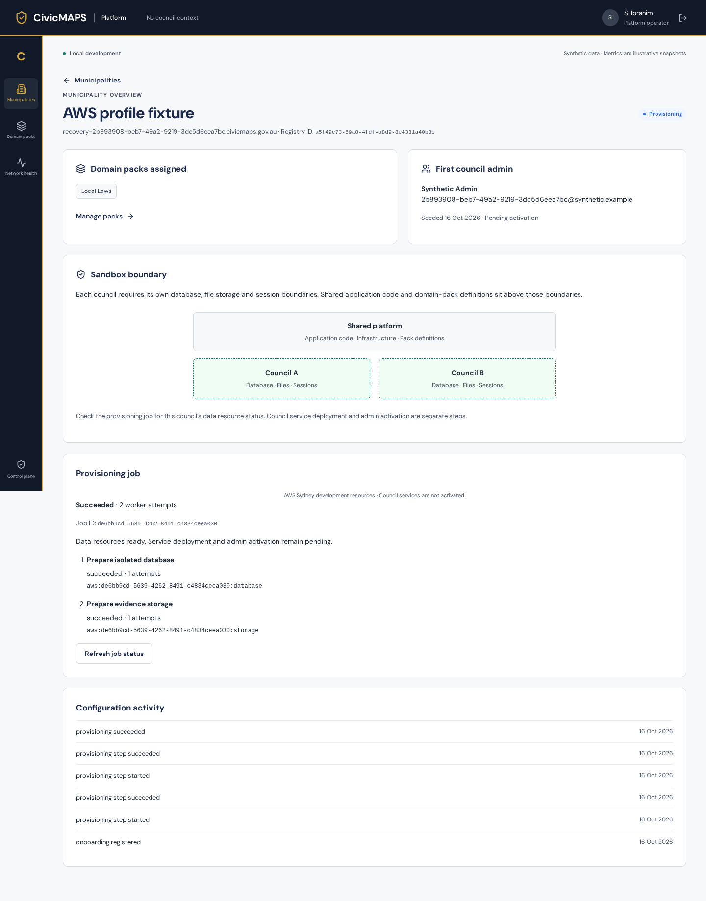
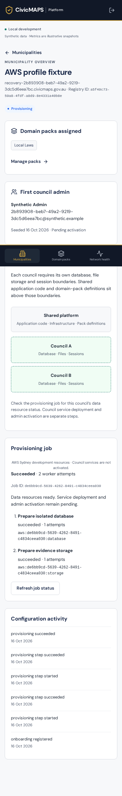

# F05 — isolated municipality data resources

Recorded 16 October 2026 by Codex (agent), on `codex/civicmaps-f05-build`, [PR #12](https://github.com/TechCorp25/CivicMaps-rebuild/pull/12), based on merged preparation `8fb71bd1cbec4cd630deece5ec9ec589e2763f98`. Implementation source: `a5c218cdf4f10752db4f1d5fce07458973c11d9f`, pinned in the [ledger](../civicmaps-feature-ledger.json). The publication follow-up adds the final provider failure-case assertion and evidence/ledger metadata. Owner merge remains separate.

## Delivered behaviour

Explicit AWS development jobs now provision isolated PostgreSQL databases/runtime logins and independently authorised S3 namespaces through the existing durable worker. Migration 007 adds owned inventory/context bindings without promoting historical synthetic jobs. Secrets remain in Secrets Manager. The actual authenticated backend resolver validates server-derived context, inventory and secret binding before opening an independent resource connection. UI status distinguishes AWS resources from simulation and keeps service deployment/admin activation pending. The two-municipality development limit and maintenance pause apply before effects.

See the [resource contract/runbook](../../development/data-resources.md), [preparation matrix](../F05-preparation.md#acceptance-matrix), [AWS preflight](F05-aws-preflight.md), [template](../../../infrastructure/f05/aws-development.json), and [Guard rules](../../../infrastructure/f05/development.guard).

## Target and owned inventory

Profile `CivicMAPS`; project `597663815195`; selected Region `ap-southeast-2`. CLI 2.38.0, configured Region, STS identity and a live AWS MCP documentation/skill call were verified. The renewed identity is `AccountFullAccessRole`. The latest plan check remained ACTIVE FREE and reported US$118.43 credits (initial preflight: US$100); this credit balance is not a calculation of actual spend; the owner approved US$50/month and US$15 for the initial seven days. These values are a development spending allocation, not a provider-enforced hard cap.

CloudFormation stack: `civicmaps-f05-development`, stack ID `6dc60bb0-c79b-11f1-80c2-02ffdeea7e13`.

| Resource | Exact identifier / disposition |
| --- | --- |
| Private RDS | `civicmaps-f05-development-database-siqbhsmut3gm`; PostgreSQL 18.6, db.t4g.micro, 20 GiB encrypted gp3, Single-AZ, one-day backups; retained |
| RDS endpoint | `civicmaps-f05-development-database-siqbhsmut3gm.c7gy0o46a48t.ap-southeast-2.rds.amazonaws.com` |
| Alpha database/login | `civicmaps_f0500000000040008000000000000001` / `runtime_f0500000000040008000000000000001`; populated synthetic record retained |
| Beta database/login | `civicmaps_f0500000000040008000000000000002` / `runtime_f0500000000040008000000000000002`; populated synthetic record retained |
| Runtime secret references | `civicmaps/f05/f0500000-0000-4000-8000-000000000001` and `...0002`; values never published |
| Storage bucket | `civicmaps-f05-development-storage-iq7jtwcoip2y`; encrypted, versioned, public access blocked; retained |
| Alpha prefix | `municipalities/20000000-0000-4000-8000-000000000001/f0500000-0000-4000-8000-000000000001/` |
| Beta prefix | `municipalities/20000000-0000-4000-8000-000000000002/f0500000-0000-4000-8000-000000000002/` |
| Runtime role | `arn:aws:iam::597663815195:role/civicmaps-f05-development-runtime`; each issued session restricts access to one prefix |
| Acceptance runner | `i-0bdd5db2c27842748`; t3.micro, encrypted 12 GiB EBS, no inbound rules; verified stopped after acceptance; encrypted EBS retained |
| VPC | `vpc-0902d21c7dcbb3701`; subnets `subnet-08ffc77473197c609`, `subnet-0cd6e7534c27367aa`, `subnet-002d36c972a243873` |

Alpha/Beta job IDs are `f0500000-0000-4000-8000-000000000001` and `...0002`; municipality IDs use `20000000-0000-4000-8000-000000000001` and `...0002`. Resource completion does not create user grants. Acceptance creates explicit context bindings only inside its disposable control database and drops that database afterwards. Cloud databases, secrets and storage ownership markers remain for review; they are not connected to a deployed council service.

## Executed provider acceptance

SSM command **`40fb7851-d80b-4f5b-bc28-645371c3de50`** completed **Success**, with empty stderr. Its [structured result](F05/cloud-acceptance.json) records timestamps and inventory. It ran `tests/cloud-data-resources.mjs` on the authorised Sydney runner with the explicit `F05-synthetic-only` selector. Its uploaded source archive SHA-256 is `edbe575a53adfbb3465be2ef8b73ba9bb9c84c503ed666e1a7520ad11c4a63fa`, verified on the runner before extraction. The adapter, worker integration, API and provider harness were compared byte-for-byte against that archive before publication.

| Matrix row | Executed result |
| --- | --- |
| Alpha/Beta and replay | Exactly two stable databases, logins, tagged secret references and prefixes; repeated provisioning preserves passwords and inventory |
| Real authentication | Independent own logins succeed with observed `SCRAM-SHA-256` server challenges; server password encryption is SCRAM; wrong, empty and cross-paired passwords fail; credential fallback uses a private empty password file |
| Database isolation | Both real runtime logins denied sibling, `postgres` and `template1` connections; denied schema/database/role creation, provisioner role escalation and privileged catalog/schema-ledger reads; plaintext connections rejected |
| Actual backend | Swapping a real runtime password to the other municipality's password causes the same resolver used by HTTP to reject authentication; restoration recovers access. Forged context fails through resolver and actual authenticated HTTP route; repeated access uses fresh resource connections |
| Storage isolation | Own list/read/write/delete succeed; sibling list/read/write/delete, root listing and forged keys denied by S3. Runtime attempts to read master secrets or assume another role denied |
| Partial create and credential failure | A real owned login is disabled before the worker runs; its authentication failure persists a failed job with no resource checkpoint/false inventory or leaked password. Restore login and the real operator retry operation recover the same owned resources |
| Partial/crash recovery | A separate worker process exits after the committed database effect before checkpoint; expiry/restart recovers the same resource/credential and rejects old-lease completion |
| Data upgrade/replay | [Initial live run](F05/initial-upgrade-run.json) `8f46c13b-3b47-4dc9-bea8-2b9df51810da` passed injected version-2 failure on both populated version-1 databases, retaining data; subsequent worker upgraded successfully. Final run replays version 2 without record loss. CI repeats the version-1 failure/upgrade transaction independently |
| Synthetic history | Dedicated 006→007 migration/seed/replay test snapshots users/password hashes, service records/capture bindings, context grants/bindings, audit, jobs, steps and synthetic effects; no resource or access binding is created from history |
| UI and audit | Existing F04 navigation, poll-outage recovery, retry/reconcile, worker process and secret-free audit regressions pass; AWS profile labels/readiness covered through the real API with a local adapter fixture |
| Rollback/cleanup | Both owned runtime logins disabled and verified unable to connect, then restored without data/password loss. Disabled registry access rejects the real resolver. Disposable control databases removed; populated cloud data preserved |

The [first complete isolation run](F05/cloud-isolation-initial.json) also succeeded on source `a5c218c`; the final follow-up adds the durable worker credential-failure assertion. Lint and formatting passed again after this test-only addition.

Intermediate failures were harness defects, not accepted evidence: `GetObject --cli-input-json` returned `ParamValidation`; explicit bucket/key arguments succeeded under the same restricted session and fixed the final run. `SHOW rds.force_ssl` is not a SQL-visible parameter on this target; effective TLS enforcement is instead proved by real plaintext rejection and the deployed parameter configuration. No trust-based local connection is counted as cloud authentication proof.

## Build and infrastructure validation

- `npm run check`: lint with zero warnings, formatting, both TypeScript/build pipelines and **47/47 integration tests**.
- `npm run test:platform:browser`: registration, navigation/poll recovery, durable retry/reconcile, process restart, packs/audit, authentication and narrow layout; AWS status fixture included.
- `npm run test:commandmaps:browser`: disposable database; create → assign → reload → officer acknowledge → attend → close; audit, cross-context denial, logout and narrow layout.
- Generated-token diff and `git diff --check`: clean.
- `cfn-lint` 1.40.2: no findings with only engine-catalog rule E3691 excluded. Its bundled catalogue does not know PostgreSQL 18.6; live Sydney RDS orderable options verified PostgreSQL 18.6/db.t4g.micro/gp3/20 GiB before creation. This is an explicit catalogue limitation, not a claim of an unsuppressed pass.
- `cfn-guard` 3.1.2: **PASS**, zero violations against all three committed F05 rules (private retained encrypted RDS/TLS/SCRAM, private encrypted versioned S3, managed runner without inbound access). This scoped rule set is not a comprehensive compliance certification.
- AWS `validate-template` passed and CloudFormation creation completed. These do not replace runtime isolation tests.

Local verification used Node 24.19.0/npm 11.9.0, PostgreSQL 18.4 and Playwright Chromium. The runner used Node 24.19.0 and disposable local PostgreSQL 15 for the control plane; real data authentication/storage acceptance used AWS RDS 18.6/S3. [Hosted source CI 38803444699](https://github.com/TechCorp25/CivicMaps-rebuild/actions/runs/38803444699) passed all steps for `a5c218c`, including both browser suites. Hosted CI uses its existing pinned PostgreSQL 15 service and explicitly runs both browser suites; provider tests remain opt-in and are not represented as hosted CI.

Screenshots below are **local UI adapter fixtures**, not screenshots of a deployed council service. Live provider proof is the SSM acceptance above.

## Retention and limits

ReviewAfter is **21 October 2026**. Preserve populated resources under the approved retention decision; do not interpret the date as deletion approval. RDS/S3 Retain policies and database deletion protection are intentional. Database baseline list price is US$21.01/month before credits/tax and other charges; the preflight records the calculation. Stopping the runner reduces compute/public-IP charges, while RDS, secrets, EBS and storage continue to cost money. Check actual spend in AWS Settings > Billing.

After acceptance, EC2 reported the runner stopped; RDS remained available, private/encrypted, on PostgreSQL 18.6 with its parameter group in sync. Current acceptance objects were deleted by the harness; versioned history, ownership markers and the reproducible source archive remain in the retained bucket. No populated/foreign resource was deleted.

The broker/provider administrator remains privileged across municipalities. Existing issued storage sessions can remain usable for up to 15 minutes after broker access is disabled; urgent provider revocation needs an explicit bucket deny. No production data, service deployment, DNS, admin activation, immutable evidence policy or dedicated-compute boundary is claimed. F06 remains planned and dependent on owner acceptance/merge of F05.
