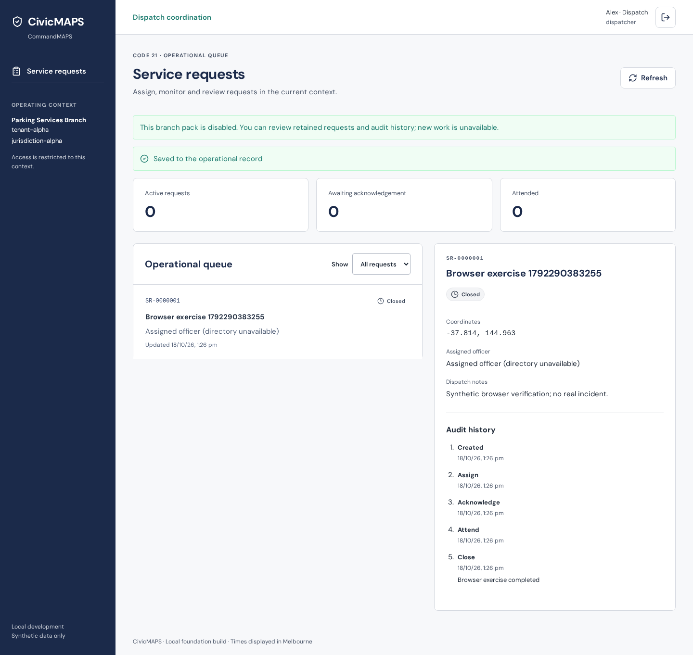

# F08 — Server-enforced pack entitlements

Codex (agent), 18 October 2026. Implementation branch `codex/civicmaps-f08-entitlements` is stacked on PR #20's planning/release-closure head `4ed9352798ee309df918fc9fbc839bd87d1cbaba`. [D03](../F08-D03-decisions.md) was explicitly approved by the owner; receipt `6ad42b2cbeb1d96470603894`. F07 remains the deployed release at `2b73318`; this feature has not been deployed.

## Behaviour

Migration 013 separates nine stable pack IDs from display labels, accepts immutable legacy-label aliases, and maps existing `parking` contexts to `parking-services` without rewriting bindings or captured request history. Only approved Alpha/Beta fixtures explicitly gain parking; other Local Laws assignments remain Local Laws. Repeated migrations/seeding preserve disabled configuration.

The server resolves current capabilities from the authenticated actor's effective context and municipality configuration. ADMIN remains limited to own profile/context. Unknown mappings fail closed. Enabled capabilities retain existing dispatcher/officer/supervisor restrictions. Disabled packs permit already-authorised request/audit review, including officer assignment and council isolation checks, while denying create, assign, close, acknowledge, attend, personnel directory and resource access. Mutation checks precede idempotency receipt replay.

Resolution takes a municipality row share lock until the operation commits. Operator disable takes a conflicting update lock: earlier authorised work commits before disable; work waiting behind disable sees the disabled state. Restrictive application-role RLS also denies disabled writes. Configuration changes append operator-attributed pack history and increment a separate pack version. Re-enable uses the same normal audited update path, without recreating records or extending role/context grants.

Platform controls submit stable IDs and render catalogue labels. The shared CommandMAPS shell consumes server capabilities, refreshes every ten seconds and on focus, hides unavailable controls, and shows retained-review status. Older overlapping refresh results are ignored. The existing request queue is the bounded consumer; this feature does not claim a completed map/GIS, chalking, ANPR, infringement or mobile implementation. See the [preview capability baseline](../F08-parking-capability-baseline.md).

## Verification

- `npm run check`: lint, formatting, both type checks/builds and integration suite. All **74 integration tests** passed. Implementation commit `772d6fa4d0a663e77af42413ed95e9b72e079c6a` was pushed and its remote SHA verified. Draft [PR #21](https://github.com/TechCorp25/CivicMaps-rebuild/pull/21) targets PR #20. Hosted results and external Codex review are recorded in that PR and Empirical `6ad42e3dbeb1d96470603a5b`; they remain required before owner merge.
- Dedicated PostgreSQL 17 disposable databases: stable catalogue/rename/alias validation, explicit fixture-only migration, unknown-context denial, stale sessions and receipt replay, read scope/cross-council denial, direct application-role disabled writes, audited recovery versions and preserved records.
- Actual lock contention verifies both commit orderings. A waiting entitlement resolver observes the committed disable; an already-authorised direct application write holds operator disable until commit.
- Populated F07 upgrade preserves identities/password hashes, ADMIN sessions/grants, bindings, routes/resources, request capture and audit; replay never re-enables disabled parking. Earlier F07 preservation checks explicitly account for the intentional pack canonicalisation and version advance.
- Chromium Platform, CommandMAPS and F07 activation suites pass. CommandMAPS checks automatic refresh into disabled review, hidden controls, retained history, re-enable, cross-council denial, narrow officer layout and logout. Screenshot above was inspected.
- Actual Caddy contract and login-isolation suites pass against local HTTP fixtures. These are not live TLS or AWS F08 acceptance claims.
- Targeted Codex review found two UI issues (request-row fallback and misplaced review notices); both were corrected and verified. Final targeted review found no further actionable findings. Hosted checks are separate publication evidence.

## Release boundary

No AWS changes or F08 deployment were made. Owner merge and a qualified source-pinned F08 live release remain separate. Before a later release, capture populated control data/configuration, verify the runtime broker's inherited application function permissions, apply migration 013 with the existing migration identity, and verify explicit Alpha/Beta enablement, retained Alpha ADMIN and disabled Beta ADMIN state, role/route/resource isolation, disable races and compatible recovery. Do not rerun provisioning/bootstrap or resurrect revoked grants. Recover configuration through a new audited version; do not restore a permissive bypass or roll back to code that ignores entitlements.
