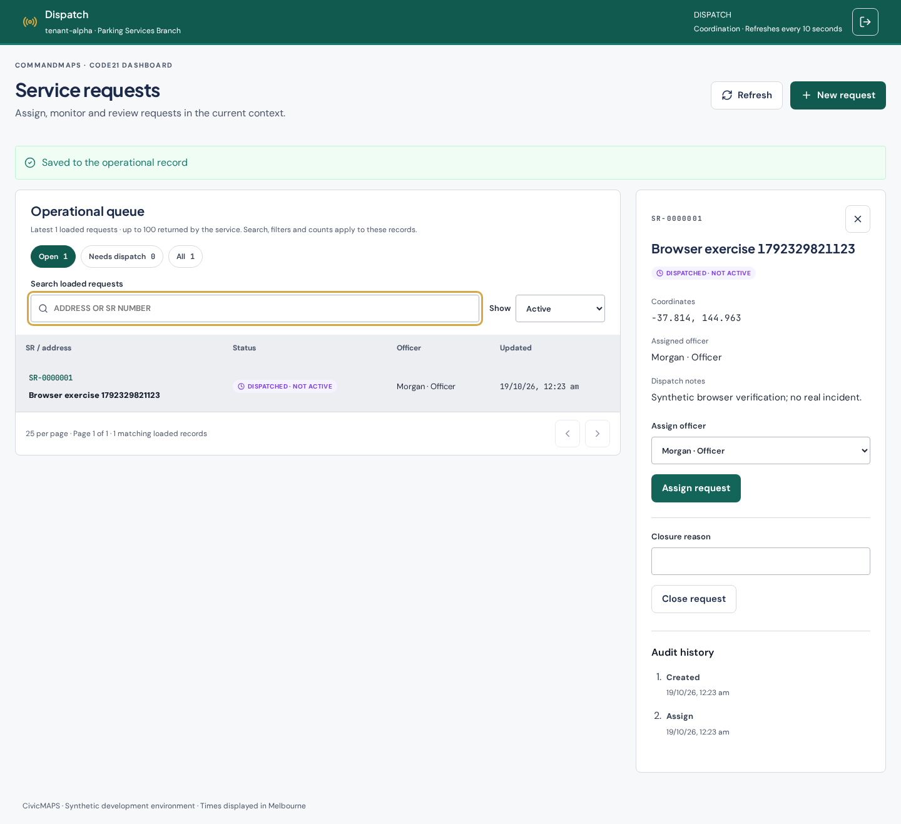
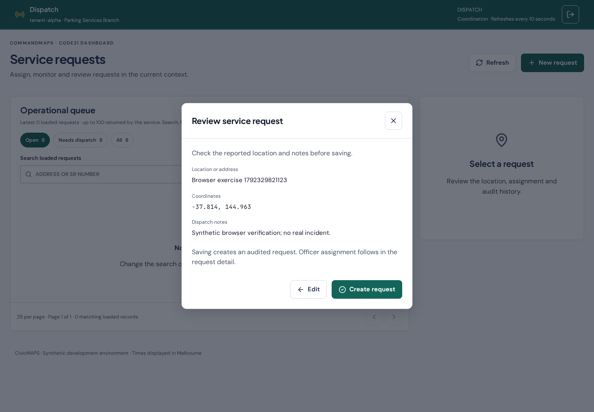
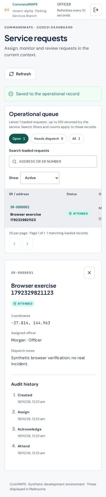
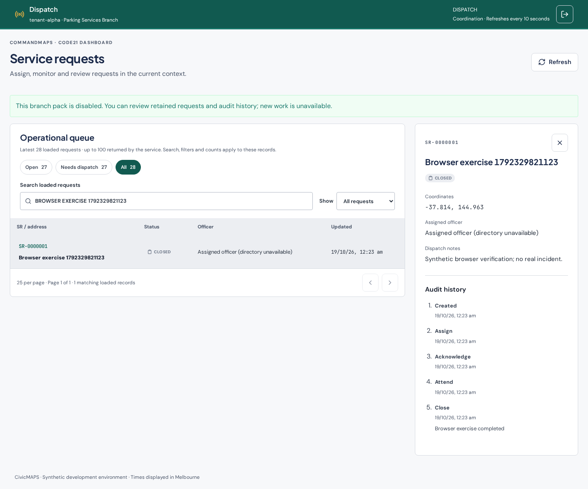

# F11D — Dispatch workspace and workflow fidelity

19 October 2026 (Australia/Melbourne). Agent-authored implementation and local qualification record. This bounded precursor does not complete F11 personnel provisioning/new-council connection, F09 suspension or the full eleven-state dispatch lifecycle.

## Delivered outcome

CommandMAPS dispatch uses the supplied Operations Teal coordination header and department/role identity, a semantic request table with search/filter chips and 25-row pagination, canonical lifecycle status components and right-side request detail. A native modal presents creation → review → edit/confirm; it requires explicit coordinates, retains values and review after save failure, supports retry, Escape/cancel and focus restoration. Existing API mutations remain server-authorised, versioned and idempotent. Audit remains read-only. Post-auth text entry follows the supplied uppercase visual rule without changing stored input values.

[Scope and design trace](../dispatch-workspace-plan.md) identifies the exact `_ds` rules, S6/S7 wireframes/annotations and functional examples, plus the pinned authorised preview reference. No canonical design files, backend/schema, permissions or AWS resources changed. Shared design JSX uses the automatic JSX runtime in production and the disposable browser harness; canonical CSS is imported directly rather than reproducing its token values.

## Qualification

- `npm run check`: lint/format, both app typechecks/builds and 75 integration tests. PostgreSQL 17 local development binaries and Node 24.19.0; hosted CI independently uses its pinned PostgreSQL 15 service. Final local run passed all 75 tests.
- `npm run test:commandmaps:browser`: disposable database, API, Vite and Chromium. Create/review/Edit retains values; synthetic HTTP 503 leaves review and enables retry; successful retry creates the audited request. Explicit coordinate entry, header identity/teal colour, search/empty result, actual 27-record pagination, page reset, selected detail, reload, assign → officer acknowledge → attend → close, persistent audit/version, Beta denial, disabled-pack retained review, re-enable, Escape, focus restoration, logout and narrow overflow checks pass; no browser page errors.
- `npm run test:activation:browser`: operator delivery, explicit context, token expiry/reissue/single-use, password sign-in/reload, ADMIN least privilege and disable/session revocation pass with the shared CSS.
- Source/design review: canonical component and CSS reuse, no new raw UI colours, labelled controls/table headings/native modal focus boundary, conservative capability handling, no personal name in the header, no new write authority. This is agent review, not an independent security or legal assessment.

Earlier qualification attempts exposed environment/setup issues: Chromium download had not finished, and `pg_dump`/restore tools were absent from PATH. The final environment includes both. A retained-review browser locator also needed to search for an older record after pagination was introduced. Assertions were adapted to the actual table and canonical status text, not removed.

## Local browser evidence

All images contain disposable synthetic data, captured by the updated browser suite; none are new live-deployment screenshots.

## Remaining boundaries

The API still returns only the latest 100 authorised requests. Search/filter/counts/pagination explicitly apply to that loaded set; F-002 server completeness remains with governance G04. The UI makes no full-queue claim. Updates use existing ten-second polling, not WebSockets; no demo live channel, SOS, priority, zone, ETA or offence data is invented. Only the five implemented server states are mapped to canonical presentation. No infringement, evidence outcome, address lookup/zone resolution, automatic dispatch, general personnel management or expanded grants are implemented. Canonical font delivery retains DR-23's local mono/display font gap and supplied CDN fallback. Production deployment is a separate action; accepted F08 remains unchanged.

## Publication and resumption

Branch `codex/civicmaps-dispatch-workspace`, based on main `92b3eea8b8ecfd0505afb6d62d60a001903db161`. Implementation commit `10bdab731b269f911cb0f135f2f30286db3c4cb1` was pushed and its remote SHA verified. Draft [PR #26](https://github.com/TechCorp25/CivicMaps-rebuild/pull/26); Empirical `6ad4c8e8beb1d9647060a602`. Subsequent publication-metadata commits do not alter the implementation. Consult the PR and Empirical for current published SHA, hosted CI and actual review state. No merge or auto-merge by the agent. After owner merge, the governance session consumes reviewed main through its established sync contract. Next functional work should choose another bounded dispatch requirement against `_ds` and current capabilities; resolve concrete authority/catalogue/provider decisions only where needed.
